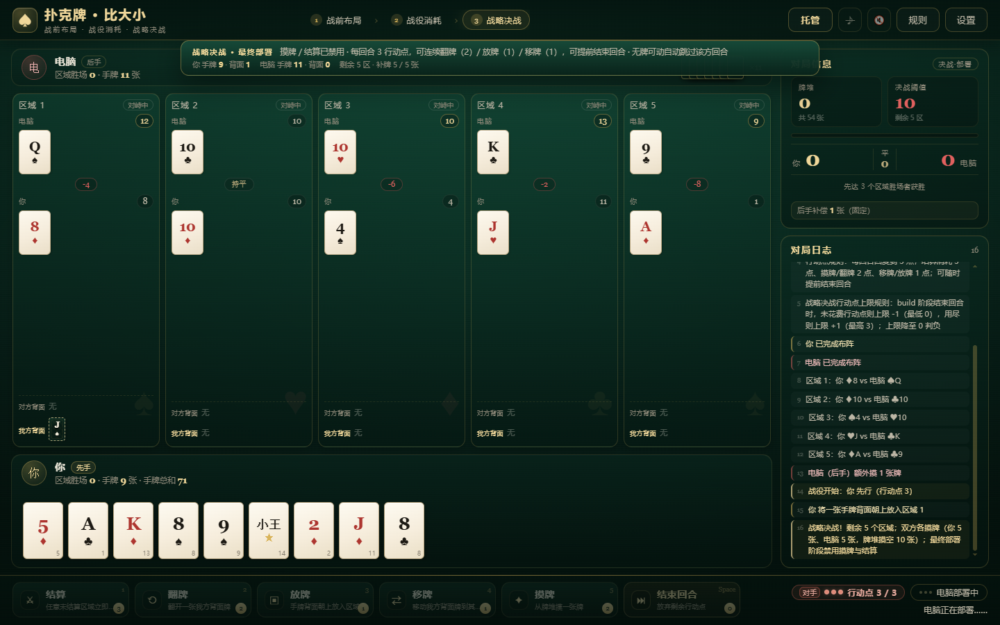
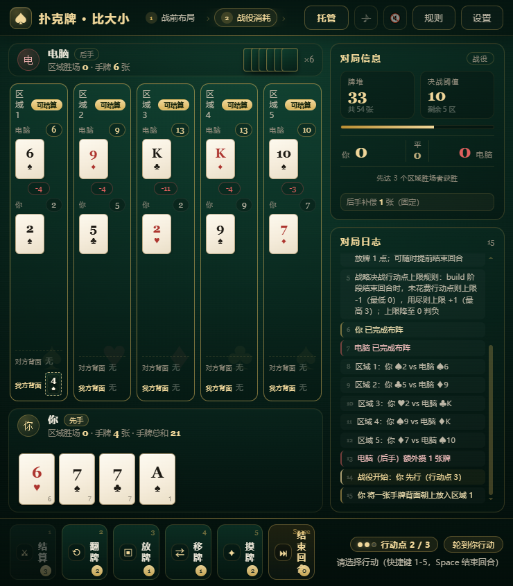
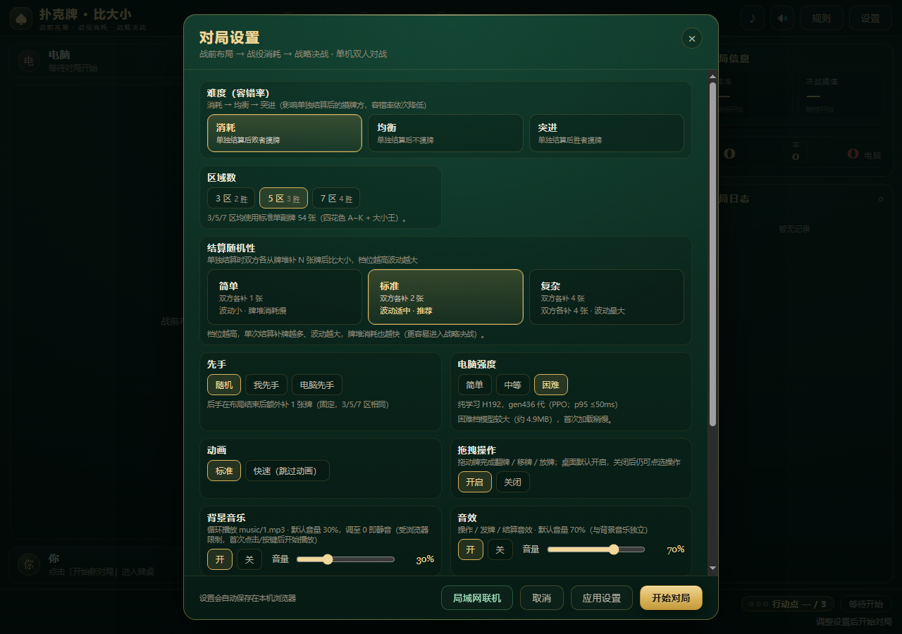

# 扑克牌 · 比大小

> 一款纯前端、零依赖、离线可玩的卡牌策略游戏：**战前布局 → 战役消耗 → 战略决战**。
> 支持单机对战电脑，以及同一局域网内的双人联机。
> 本游戏除规则外均由deepseek-flash-1017自主构建完成。

| 桌面对局 | 安卓横屏 |
| --- | --- |
|  |  |

## 特性

- **零依赖、纯前端**：只有 HTML / CSS / 原生 JavaScript，双击 `index.html` 即可离线游玩，无需安装、无需联网。
- **完整规则引擎**：3/5/7 个区域、三档结算随机性、三种难度规则、先手/后手补偿、行动点、战略决战、提前锁定、平局判定。
- **纯学习 AI 对手**：三个难度档全部内置浏览器推理，不联网、不需要训练数据；layout（战前布局）使用产品阶段基线。
- **局域网双人联机**：同一 Wi-Fi 下，一台电脑开房间（Node.js），手机/电脑浏览器输入地址即可对战；支持断线重连、双方确认再来一局。
- **可复现对局**：相同随机种子 + 相同操作 = 完全相同的牌局，方便复盘与自动化测试。
- **完整测试与调试接口**：内置 `window.PokerDebug`，Node 测试覆盖引擎、AI、联机、边界与终局判定。
- **桌面/安卓适配**：桌面 1440×900、1280×800 完整布局；安卓横屏有专门的紧凑布局与可选拖拽操作。

## 玩法

一局分为三个阶段：

1. **战前布局**：双方各摸 `2R` 张牌（R = 区域数：3/5/7），各选 R 张背面朝上放入 R 个区域，双方完成后同时揭示；后手额外摸 1 张。
2. **战役消耗**：每回合 3 点行动点（AP），轮流执行「结算 / 翻牌 / 放牌 / 移牌 / 摸牌 / 结束回合」。
   - 结算消耗 3 AP：双方按当前档位各补 1/2/4 张牌，比较区域内正面牌点数之和，胜者赢得该区域，并按难度规则摸牌。
   - 摸牌、翻牌消耗 2 AP；放牌、移牌消耗 1 AP；结束回合 0 AP。
   - 任一方区域胜场先达到 `⌊R/2⌋+1` 时立即获胜（提前锁定）。
3. **战略决战**：牌堆剩余 ≤ `2 × 未结算区域数` 时触发——双方平分并摸空牌堆，进入「最终部署」（禁用摸牌/结算，只可翻/放/移；每回合结束时的 AP 花费会影响后续 AP 上限），双方都无牌可动后按现有正面牌点数摊牌结算。

更完整的规则、结算顺序与边界裁定见 [docs/RULES.md](docs/RULES.md)。

## AI 对手

三个难度档均为**纯学习策略**（policy-only，battle/build 决策；布局沿用产品基线），模型参数内置于浏览器 bundle，无需服务器：

| 档位 | 模型 | 说明 |
| --- | --- | --- |
| 简单 | H96 / gen60 | 轻量纯学习策略，保守回退档 |
| 中等 | H128 / gen241 | 联赛 PPO 纯学习，默认档 |
| 困难 | H192 / gen436 | PPO 纯学习，最强档；模型较大，首次加载稍慢 |



## 开始游戏

### 浏览器（离线）

1. 下载或克隆本项目；
2. 直接用浏览器打开 `index.html`（`file://` 可运行）；
3. 在设置中选择区域数、结算随机性、难度与 AI 强度，开始对局。

> 浏览器对本地音频自动播放有限制；首次点击/操作后才会开始播放音乐与音效。

### 局域网双人联机

需要一台装有 **Node.js 18+** 的电脑作为房主：

- Windows：双击 `start-lan.bat`（或 `启动联机.bat`），会自动启动服务器并打开联机大厅；
- 或手动运行：`node server.js` / `node tools/launch.js`；
- 另一台电脑或手机连接同一 Wi-Fi，打开终端显示的地址（例如 `http://192.168.1.23:5200`），输入房间码加入。

联机协议、端口与已知限制见 [docs/LAN.md](docs/LAN.md)。

### Android

- 安装包：`android/dist/poker-duel-v1.01.apk`（versionName 1.01，versionCode 25，minSdk 23 / targetSdk 34）；
- 构建：`powershell -ExecutionPolicy Bypass -File android/build.ps1`（需要 JDK17 + Android SDK build-tools 34）；
- 支持三种模式：单机离线、手机当房主（本机 LAN 服务器）、加入联机；详见 [android/README.md](android/README.md)。

## 操作说明

- **点击操作**：选牌 → 区域 → 确认行动；行动按钮会显示所需 AP。
- **拖拽操作（可选）**：桌面默认开启，安卓默认关闭；拖手牌到区域 = 放牌，拖自己的背面牌回原区域 = 翻牌，拖到其他区域 = 移牌。可在设置中开关。
- **回合倒计时**：默认 30 秒，超时自动结束回合；可在设置中关闭或调整（15/30/60 秒）。
- **托管**：让简单 AI 代打本地玩家，随时可取消。

## 项目结构

```text
poker-duel/
├── index.html               # 入口（直接打开即可游玩）
├── js/
│   ├── engine.js            # 规则引擎（纯逻辑、零依赖、确定性）
│   ├── ai.js                # 启发式 AI（布局/回退）
│   ├── ai-ml.js             # 产品 ML 2.3.0（世界模型/计划评估，历史基线）
│   ├── ai-pure-simple.js    # 简单档纯学习 bundle（H96 / gen60）
│   ├── ai-pure.js           # 中等档纯学习 bundle（H128 / gen241）
│   ├── ai-pure-hard.js      # 困难档纯学习 bundle（H192 / gen436）
│   ├── main.js / ui.js      # 对局控制器 / 界面
│   └── net.js / sfx.js / music.js
├── css/                     # 样式（桌面/移动布局）
├── docs/                    # 规则、接口契约、决策记录、联机文档
├── tests/                   # Node 测试、E2E、QA 报告
├── tools/                   # 开发/训练/打包/评测脚本
├── android/                 # Android WebView 壳与 APK 构建
├── music/  sfx/             # 背景音乐与音效
├── server.js                # 局域网权威服务器
└── start-lan.bat            # Windows 一键联机启动
```

## 开发与测试

零安装依赖，确保 Node.js 18+ 即可：

```bash
# 全量 Node 测试（单元/边界/AI/联机/模拟 300 局）
node tests/run-all.js

# 跳过 300 局模拟（更快）
node tests/run-all.js --skip-sim

# 单独运行某个测试
node --test tests/engine-apcap.test.js
```

规则事实来源：[docs/RULES.md](docs/RULES.md)；引擎/AI/UI 接口契约：[docs/CONTRACT.md](docs/CONTRACT.md)。

## 文档

- [规则与实现裁定](docs/RULES.md)
- [引擎/AI/UI 接口契约](docs/CONTRACT.md)
- [局域网联机说明](docs/LAN.md)
- [Android APK 说明](android/README.md)
- [v2.18/v1.0 决策记录（困难档与版本号）](docs/DECISION-v2.18.0-hard-ai-gen436.md)
- [旧版内部开发/变更记录（归档）](docs/INTERNAL-DESIGN-README.md)

## 已知限制

- Android 真机触屏、部分浏览器与手机 WebView 的完整交互未在构建机验证（构建机无真机设备）。
- 联机只支持同一局域网；PC 房主需要 Node.js；路由器开启 AP 隔离时设备之间可能无法互访。
- 困难档模型约 4.9MB，低端设备首次加载/解析可能稍慢。
- 不含账号、公网匹配、排行榜或任何付费/博彩内容。

## 版本

- 游戏版本：**v1.01**
- 规则引擎：**1.7.0**
- AI：简单 H96/gen60、中等 H128/gen241、困难 H192/gen436（均为纯学习策略）

## 素材与许可

- 音效素材：Kenney（CC0）；背景音乐与其余素材见对应目录，使用/分发前请自行确认授权。
- 本项目未附带开源许可证；如需复用代码或素材，请先确认授权范围。
